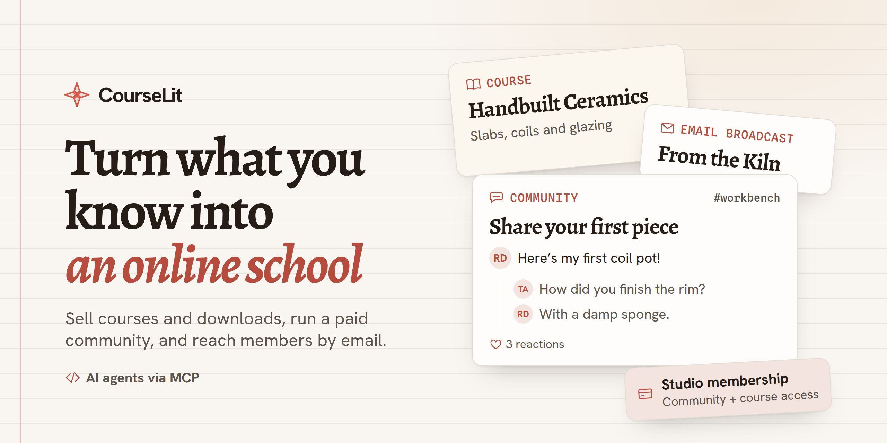

<div align="center">

<p>
  <picture>
    <source media="(prefers-color-scheme: dark)" srcset="assets/banner-dark.png" />
    
  </picture>
</p>

<p>
  
</p>

# CourseLit

**Teach, sell and build a community, from your own website.**<br />
An open-source alternative to Teachable, Thinkific and Podia.

Sell courses and digital downloads, run a paid community and email your audience from one place,<br />
through an admin dashboard, a school website, a REST API and an MCP server.

[](./LICENSE.md)
[](https://discord.gg/GR4bQsN)
[](https://hub.docker.com/r/codelit/courselit-api)
[](https://github.com/codelitdev/courselit/actions/workflows/code-quality.yml)

[Website](https://courselit.app) · [Docs](https://courselit.app/docs) · [Quick start](https://courselit.app/docs/getting-started/quickstart) · [Self-hosting](https://courselit.app/docs/self-hosting)

</div>

---

> [!NOTE]
> This is **CourseLit 1.0**, a ground-up rewrite that is in pre-release (`1.0.0-alpha`). The code of the previous version (v0.x) is available at the [`v0.74.6`](https://github.com/codelitdev/courselit/tree/v0.74.6) tag. Coming from v0.x? Read [Migrate from CourseLit v0](https://courselit.app/docs/migrate/from-courselit-v0).

## Why CourseLit

Selling what you know online usually means stitching together a course host, a website builder, a payment tool, a community app and an email service, and paying a cut of every sale along the way. CourseLit is all of that in one open-source platform, and the school and its learners belong to you.

- **Courses and downloads.** Video, audio, text, PDF, embed, quiz and SCORM lessons, drip schedules, free previews, certificates and lead magnets.
- **Communities.** Paid or free communities with spaces, discussions and moderation, which can include access to your products.
- **Your own website.** A drag-and-drop page editor, themes, a blog and a custom domain. Every product gets a sales page.
- **Get paid directly.** Learners pay through your own Stripe, Lemon Squeezy or Razorpay account, with one-time, subscription and installment plans. CourseLit takes no cut.
- **Email marketing built in.** Contacts, tags, segments, templates, broadcasts and automated sequences.
- **Built for agents.** Claude, ChatGPT, Cursor and any MCP client can build courses, set prices and manage learners for you, over OAuth. Scripts can use the REST API with an API key.
- **Many schools, one account.** One deployment hosts many schools, each with its own team, permissions, branding and domain.
- **Open source and portable.** Use [CourseLit Cloud](https://courselit.app), or run the same software on your own servers.

## Quick start

**The fastest way:** create a school on [courselit.app](https://courselit.app). It takes a few minutes, and the trial needs no card. Then follow the [quick start](https://courselit.app/docs/getting-started/quickstart) to publish your first course.

**Set it up with an AI assistant:** add `https://api.courselit.app/mcp` as a remote MCP server in Claude, ChatGPT or Cursor and sign in. Then ask it, for example, to "create a course on watercolor basics with three sections". See [MCP server](https://courselit.app/docs/developers/mcp-server).

**Call the API:** create an API key in the admin (**Settings → API keys**) and make your [first request](https://courselit.app/docs/developers/first-request).

**Run it yourself:** see [Self-hosting](#self-hosting), or [Development](#development) to run it on your computer.

## How it fits together

CourseLit is made of four apps that you run, plus a database.

| Part           | Folder           | What it does                                                                     |
| -------------- | ---------------- | -------------------------------------------------------------------------------- |
| **API**        | `apps/api`       | The REST API, the MCP server, sign-in, payments and all business logic           |
| **Worker**     | `apps/api`       | Background jobs, such as drip emails and sequences. Same code, another command   |
| **Admin**      | `apps/admin`     | The dashboard where you and your team manage a school                            |
| **Storefront** | `apps/storefront` | The school's public website, where learners buy, learn and join the community |
| **PostgreSQL** |                  | The only database                                                                |

The admin and the storefront never touch the database. They call the API, so anything you can click in the admin you can also do over REST or MCP.

CourseLit also uses two companion services from the CodeLit family:

- [**MediaLit**](https://github.com/codelitdev/medialit) stores uploaded files, such as videos, PDFs and images.
- [**SendLit**](https://github.com/codelitdev/sendlit) sends email and powers the email marketing features.

School websites are built with the page builder from [**FrontLit**](https://github.com/codelitdev/frontlit).

### Shared packages

| Package                                                     | Description                                                          |
| ----------------------------------------------------------- | -------------------------------------------------------------------- |
| [`@courselit/api-contract`](packages/api-contract)          | The typed API contract (schemas and routes) that every app shares    |
| [`@courselit/components-library`](packages/components-library) | UI components shared by the admin and the storefront              |
| [`@courselit/page-blocks`](packages/page-blocks)            | CourseLit's website blocks, such as product lists and pricing tables |

**Tech stack:** TypeScript, Bun, PostgreSQL with Drizzle ORM, ts-rest, Next.js, Tailwind CSS and shadcn/ui.

## Self-hosting

Each release publishes three Docker images: [`codelit/courselit-api`](https://hub.docker.com/r/codelit/courselit-api) (used for both the API and the worker), [`codelit/courselit-admin`](https://hub.docker.com/r/codelit/courselit-admin) and [`codelit/courselit-storefront`](https://hub.docker.com/r/codelit/courselit-storefront).

> [!WARNING]
> Self-hosting 1.0 is for experienced operators today. There is no one-command installer yet, and you need your own PostgreSQL, a MediaLit server and an email setup (SMTP or SendLit). Always pin an exact version tag and use the same one for all three images: the `latest` tag still points at the old v0.x line.

The [self-hosting guide](https://courselit.app/docs/self-hosting) walks through it step by step:

1. [Deploy the services](https://courselit.app/docs/self-hosting/deploy): run the migrations, then start the API, worker, admin and storefront.
2. [Configuration](https://courselit.app/docs/self-hosting/configuration): every environment variable, grouped by service.
3. [Domains and reverse proxy](https://courselit.app/docs/self-hosting/domains-and-proxy): school subdomains, custom domains and HTTPS.

Not sure which to pick? Compare [Cloud and self-hosted](https://courselit.app/docs/getting-started/cloud-vs-self-hosted).

## Development

This section gets CourseLit running on your computer so you can change the code.

**Requirements:** [Bun](https://bun.sh) 1.4.1 or newer, [Docker](https://docs.docker.com/get-docker/), and a MediaLit API key for uploads (free at [medialit.cloud](https://medialit.cloud), or from your own MediaLit server). We develop on Linux; on Windows, use WSL.

### 1. Install

```bash
git clone https://github.com/codelitdev/courselit.git
cd courselit
bun install
```

### 2. Start the database and email services

```bash
docker compose -f docker-compose.local.yml up -d
```

This starts PostgreSQL, SendLit and [Mailpit](https://mailpit.axllent.org), a fake inbox that catches every email the app sends. Nothing leaves your computer.

### 3. Configure the apps

```bash
cp apps/api/.env.example apps/api/.env
cp apps/admin/.env.example apps/admin/.env
cp apps/storefront/.env.example apps/storefront/.env
```

Then open `apps/api/.env` and set:

- `MEDIALIT_APIKEY` to your MediaLit API key.
- `SENDLIT_ORGANIZATION_API_KEY` to `sl_org_live_bbbbbbbbbbbbbbbbbbbbbbbbbbbbbbbbbbbbbbbbbbb`. This is a fixed key that only works with the local SendLit from step 2. Never use it anywhere else.

The other defaults already point at the services from step 2. See [the API README](apps/api/README.md) for more on the SendLit setup.

### 4. Create the database tables

```bash
bun --filter @courselit/api db:migrate
```

### 5. Start the apps

Run each command in its own terminal, and leave them running:

```bash
bun dev:api                  # API on http://localhost:4000
bun dev:worker               # Background jobs
bun dev:admin                # Admin on http://localhost:3000
PORT=3002 bun dev:storefront # School websites on http://localhost:3002
```

Open the admin at <http://localhost:3000> and sign in with any email address. In development, the sign-in code is printed in the terminal running `bun dev:api`. To receive it in Mailpit at <http://localhost:8026> instead, set `EMAIL_HOST=127.0.0.1` and `EMAIL_PORT=1026` in `apps/api/.env`. Create a school, and its website is served at `http://<your-school>.localhost:3002`.

| Service        | Address                  |
| -------------- | ------------------------ |
| Admin          | <http://localhost:3000>  |
| Storefront     | <http://localhost:3002>  |
| API            | <http://localhost:4000>  |
| Mailpit inbox  | <http://localhost:8026>  |
| SendLit API    | <http://localhost:4101>  |
| PostgreSQL     | `127.0.0.1:5432`         |

### Tests and checks

```bash
bun run test        # Unit tests in every workspace
bun run typecheck   # TypeScript in every workspace
bun run lint        # Biome lint
bun run format      # Biome format (bun run format:check in CI)
```

### Something not working?

- **No sign-in email?** Look for the code in the `bun dev:api` terminal. If you set `EMAIL_HOST`, check Mailpit at <http://localhost:8026>.
- **The API stops at startup and names missing tables?** Run the migrations from step 4 again.
- **The API stops and asks for MediaLit?** Set `MEDIALIT_SERVER` and `MEDIALIT_APIKEY` in `apps/api/.env`.
- **Email marketing says it is still setting up?** The worker connects each new school to SendLit in the background. Make sure the worker is running and `SENDLIT_ORGANIZATION_API_KEY` is set.

## Documentation

The docs live in [`frontlit/docs`](frontlit/docs) as Markdown and are published at [courselit.app/docs](https://courselit.app/docs). The running API also serves its OpenAPI reference. Docs for v0.x are under [`frontlit/docs/legacy`](frontlit/docs/legacy).

## Contributing

Contributions are welcome, including from first-time contributors. For anything larger than a small fix, please open an issue first so we can agree on the approach.

1. Fork the repository and create a branch.
2. Make your change, with tests. Read [AGENTS.md](AGENTS.md) for the project's rules, for example how REST and MCP stay in sync.
3. Run `bun run lint`, `bun run format`, `bun run typecheck` and `bun run test`.
4. Write your commit messages as [Conventional Commits](https://www.conventionalcommits.org), such as `feat(storefront): show partly refunded purchases`. A commit hook checks this for you.
5. Open a pull request. The checks run on every pull request and must pass.

Questions are welcome on [Discord](https://discord.gg/GR4bQsN) or in [GitHub issues](https://github.com/codelitdev/courselit/issues).

## Security

Please don't report security issues in public issues. Report them privately through [GitHub's security advisories](https://github.com/codelitdev/courselit/security/advisories/new). See [SECURITY.md](SECURITY.md).

## Licensing

CourseLit is licensed under **AGPL-3.0**. Self-hosting is free. If you run a modified CourseLit as a hosted service, you must share your changes under the same license. The license text is in [LICENSE.md](./LICENSE.md).
