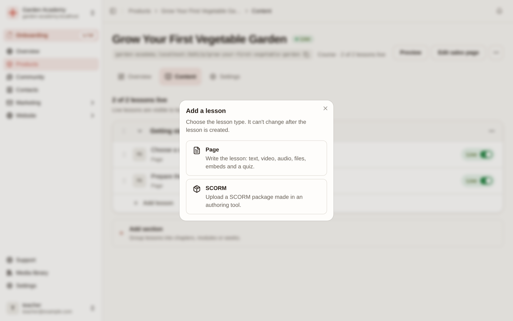
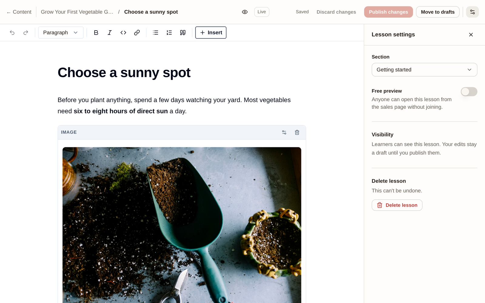
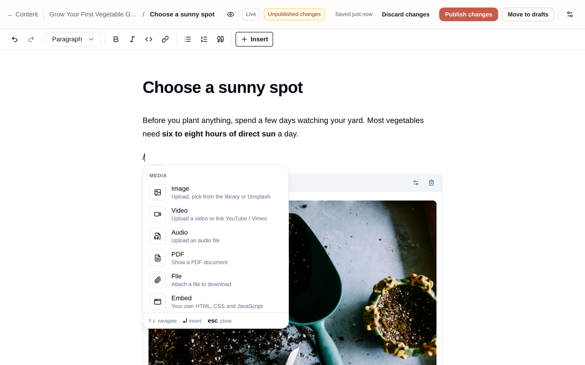

A course lesson is one of two types:

| Type | What it is |
| --- | --- |
| Page | A lesson you write in the full-screen editor, built from blocks: text, images, video, audio, PDF, files, embeds, callouts and one quiz, in any order. |
| SCORM | A package made in a SCORM authoring tool. Needs the Business plan on hosted CourseLit. See [SCORM lessons](/docs/products/scorm). |

You pick the type when you create the lesson, and it can't change afterwards. Most lessons are pages.

A [digital download](/docs/products/digital-downloads) doesn't have lessons. Its **Files** tab holds the files buyers download.

## Create a lesson

On the product's **Content** tab, select **Add lesson** at the bottom of a section. The **Add a lesson** dialog asks you to choose the type.

- **Page** creates a draft lesson called "Untitled lesson" and opens it in the lesson editor.
- **SCORM** opens the lesson form, where you enter a title and upload the package.

## The lesson editor

A page lesson opens in a full-screen editor. The lesson title is the large heading at the top; type over it to rename the lesson. The page goes below it.

The toolbar above the page formats text (paragraph style, bold, italic, code, links, lists and quotes). Its **Insert** button opens the list of blocks.

### Add blocks

Type `/` on an empty line to open the insert menu, or select **Insert** in the toolbar. Keep typing to filter the list, use the arrow keys to move and press Enter to add a block.

| Group | Blocks |
| --- | --- |
| Text | Text, Heading 2, Heading 3, Heading 4, Bullet list, Numbered list, Quote, Code block, Divider, Table |
| Media | Image, Video, Audio, PDF, File, Embed |
| Layout | Callout, plus Warning, Tip, Success and Danger callouts |
| Interactive | Quiz |

Drag the handle beside a block to move it. Each block has a settings icon and a trash icon in its header.

### Media blocks

- **Image**: upload an image, pick one from your media library, or choose a photo from Unsplash. Add **Alt text** in the block's settings. Unsplash photos are not added to your media library.
- **Video**: upload a video, or link a YouTube or Vimeo video.
- **Audio**: upload an audio file.
- **PDF**: show a PDF document in the page.
- **File**: attach any file for learners to download.
- **Embed**: your own HTML, CSS and JavaScript, such as a form or an interactive widget. It runs in a sandboxed frame.

Each media block only takes files of its own kind: a Video block takes a video, a PDF block a PDF. Uploaded files are stored privately, so only people who can open the lesson can open them.

<Callout type="note" title="Embed and your plan">

The Embed block is not available during the free trial on hosted CourseLit. It shows greyed out in the insert menu as "Not available during the trial". It becomes available when you choose a paid plan. On a self-hosted install, Embed is always available. YouTube and Vimeo videos don't need Embed: use the Video block.

</Callout>

### Quiz

A page can hold one Quiz block. Learners must pass it before they can mark the lesson complete. See [Quizzes](/docs/products/quizzes).

### Lesson settings

The settings icon at the right of the top bar opens **Lesson settings**:

- **Section**: move the lesson to another section.
- **Free preview**: let visitors open the lesson from the sales page. See [Free preview lessons](/docs/products/free-preview-lessons).
- **Visibility**: whether learners can see the lesson.
- **Delete lesson**: delete it for good.

## Saving, drafts and publishing

The editor saves as you type. The top bar shows "Saving…" and then "Saved just now".

Page edits are saved as a draft, so learners never see a half-finished change. They keep reading the published page until you publish. While a live lesson has edits learners don't see yet, the top bar shows **Unpublished changes** next to **Live**.

| Button | What it does |
| --- | --- |
| **Publish changes** | Learners see the new page right away. |
| **Discard changes** | After you confirm "Discard your unpublished changes?", the page goes back to the version learners see. Discarded edits can't be recovered. |
| **Make live** | Makes a draft lesson visible to learners and publishes its page at the same time. |
| **Move to drafts** | Hides a live lesson from learners. Your unpublished edits are kept. |

**Publish changes** and **Discard changes** are only active when there are unpublished changes. Changes to the title, section and free preview apply right away and don't need publishing.

If something on the page blocks publishing, such as a quiz question with no correct option, a message above the page lists what to fix. You can keep editing and saving; the page just can't be published or made live until it's complete.

If someone else, or an AI assistant, changes the lesson while you have it open, the editor stops saving and asks you to **Reload**, so nobody's work is overwritten.

## What learners see

Learners open lessons in the course viewer. A page shows its blocks in order, styled with your school's theme. When they finish, they select **Mark complete**.

- A page with a quiz can be marked complete only after the learner passes the quiz. Otherwise they see "Pass the quiz to complete this lesson."
- A SCORM lesson can be marked complete only after the package has reported progress.

Completing every live lesson finishes the course and, when [certificates](/docs/products/certificates) are on, issues the certificate.
