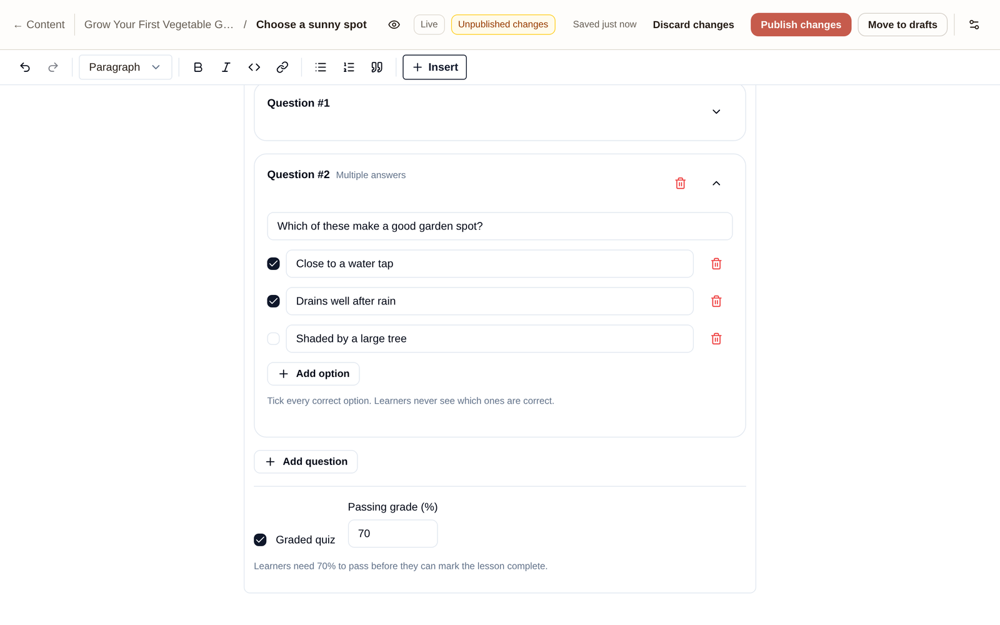

A **Quiz** is a block you add to a [page lesson](/docs/products/lesson-types). Learners answer its multiple-choice questions and get a score straight away. A lesson can hold one quiz, and learners must pass it before they can mark the lesson complete.

## Add a quiz

In the lesson editor, type `/` on an empty line (or select **Insert**) and choose **Quiz** under **Interactive**. Once the page has a quiz, the **Quiz** entry is greyed out with the note "A lesson holds one quiz".

## Write the questions

The block starts with **Question #1**. For each question:

1. Type the question in **Enter question**.
2. Fill in each option. Select **Add option** to add more.
3. Tick the checkbox next to every correct option.

Select **Add question** to add another question. Use the trash icons to delete a question or an option, and the arrow to collapse a question.

A question with one correct option is a single-answer question: learners pick one option. Tick more than one and it becomes a multiple-answer question, labelled **Multiple answers**: learners see "Choose all that apply." and can pick several.

A quiz can have up to 100 questions, and a question up to 20 options.

### Before you can publish

You can keep saving a quiz while you write it. To publish the page or make the lesson live, every question needs text, at least two options with text, and at least one correct option. Until then, a message above the page tells you what to fix.

## Set a passing grade

Below the questions, **Graded quiz** controls whether learners must reach a score.

| Setting | Effect |
| --- | --- |
| Graded quiz on | Learners must score at least the **Passing grade (%)**, a number from 0 to 100. The default is 70. The editor reads, for example, "Learners need 70% to pass before they can mark the lesson complete." |
| Graded quiz off | "Without a pass mark, every attempt passes." Learners still see their score. |

## How scoring works

Each correct option a learner chooses earns one point. The score is the points earned as a percentage of all correct options in the quiz. Two rules stop a learner from passing by ticking everything:

- In a single-answer question, a learner can choose only one option.
- In a multiple-answer question, each wrong option chosen cancels one correct option. A question never scores below zero.

For example, a quiz with one single-answer question and one question with two correct options has three points in total. A learner who gets the first question right and picks both correct options in the second, plus a wrong one, scores 2 of 3, or 66.67%.

## What learners see

Learners answer the questions and select **Submit answers**. CourseLit grades the attempt and shows **Passed** or **Not passed** with their score, for example "Score: 66.67% · Passing grade: 70%".

- Learners never see which answers were correct, not even after submitting. Correct answers never leave CourseLit's servers, so they can't be found in the page either.
- A learner can try again as many times as they like. Very many attempts in a short time are paused for a few minutes.
- If you change the quiz while a learner has it open, they are told "This quiz has changed since you opened it." and get the new version.

## Completion

A learner can't select **Mark complete** on a lesson with a quiz until they have passed it; they see "Pass the quiz to complete this lesson." Passing doesn't complete the lesson on its own: the learner still selects **Mark complete**.

So a quiz must be passed before its lesson counts towards finishing the course and earning a [certificate](/docs/products/certificates).

## Limits

- Only learners with access can take a quiz. A lesson with a quiz can't be a [free preview](/docs/products/free-preview-lessons).
- When you [preview a course](/docs/products/preview-a-course), you see the questions but can't submit them: "Enrolled learners answer this quiz to complete the lesson."
